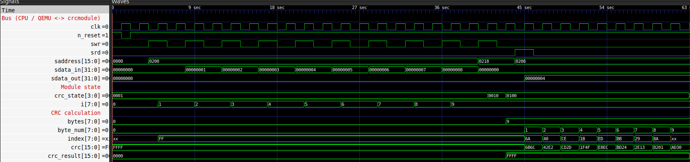

# Verilog module - crcmodule

Hardware implementation of the **CRC16-CDMA2000** checksum (polynomial `0xC867`, initial value `0xFFFF`). The module stores up to 250 data bytes and computes the CRC one byte per clock cycle using a 256-entry look-up table generated at start-up. Inside QEMU the module is driven by the CPU through memory-mapped registers accessed in dricetory `/sys/kernel/crcmodule_sysfs/`.

## Files
| File | Description |
|---|---|
| `crcmodule.v` | the module |
| `crcmodule_tb.v` | self-checking testbench |
| `crcmodule.gtkw` | layout for the waveforms |

## Interface
| Port | Width | Description |
|---|---|---|
| `clk` | 1 | clock |
| `n_reset` | 1 | asynchronous reset, active low |
| `saddress` | 16 | register address |
| `swr` | 1 | write |
| `srd` | 1 | read |
| `sdata_in` | 32 | data from the CPU |
| `sdata_out` | 32 | data to the CPU |

Bus:
- **write one byte** - set `saddress` and `sdata_in`, hold `swr = 1` for exactly one clock cycle,
- **read one byte** - set `saddress`, hold `srd = 1` for exactly one clock cycle, then sample `sdata_out`.

## Registers
| Register | Offset | Access | Description | How it works |
|---|---|---|---|---|
| IN | `0x200` | write | one data byte (`sdata_in[7:0]`) appended to the buffer | accepted only when STATE bit 0 = 1; the byte is stored at the next free position and clears STATE bit 3; the 250th byte clears STATE bit 0 (buffer full); next bits of `sdata_in` are ignored |
| STATE | `0x208` | read | module state, bits `[3:0]` | returns the current state bits |
| RESULT | `0x210` | read | CRC result (`[15:0]`), `0xFFFF` while not ready | returns the CRC when STATE bit 3 = 1, otherwise `0xFFFF` |
| CTRL | `0x218` | write | `0x00` - calculate CRC of the buffered bytes | starts the calculation only if the value is `0x00`, the buffer is not empty and no calculation is running - otherwise ignored; after the calculation the buffer is emptied and STATE bit 0 is set again |

## Current state bits:
| Bit | Name | 0 | 1 |
|---|---|---|---|
| 0 | write allowed | data written to IN is ignored (buffer full or calculation running) | data can be written to IN |
| 1 | init | - | calculation is starting (one clock cycle) |
| 2 | calculating | no calculation | calculation running |
| 3 | ready | no result (RESULT returns `0xFFFF`) | result ready in RESULT |

## Usage
1. Write data bytes to **IN** (1-250). Bytes written when the buffer is full or during a calculation are ignored.
2. Write `0x00` to **CTRL**. The command is ignored if the buffer is empty or a calculation is already running.
3. The module needs `N + 2` clock cycles for `N` bytes (init, one cycle per byte, finish). Poll **STATE** until bit 3 is set.
4. Read **RESULT**. The buffer is now empty and the next write to IN starts a new data block.

## Testing
The module was verified in **Icarus Verilog** with the testbench `crcmodule_tb.v`:

| Scenario | Expected |
|---|---|
| bytes `0x00..0x08` | RESULT `0xAD30`, STATE `0x09` |
| `"123456789"` + extra byte written during calculation (ignored) | RESULT `0x4C06`, STATE `0x09` |
| CTRL without data (ignored) | RESULT `0xFFFF`, STATE `0x01` |
| 255 bytes written (only 250 accepted) | STATE `0x00` when full, RESULT `0x42C9` |

Run:
```bash
iverilog -o crcmodule.vvp crcmodule.v crcmodule_tb.v    # compile 
vvp crcmodule.vvp                                       # run testes
gtkwave crcmodule.vcd crcmodule.gtkw                    # show waveforms
```

<!-- Icarus Verilog / GTKWave screenshot -->
